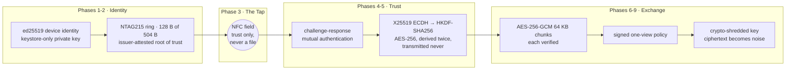
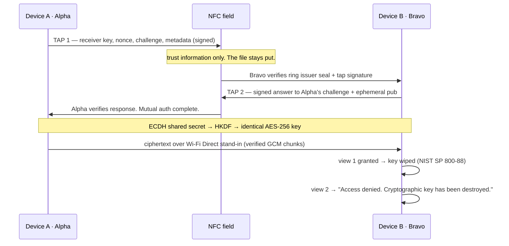
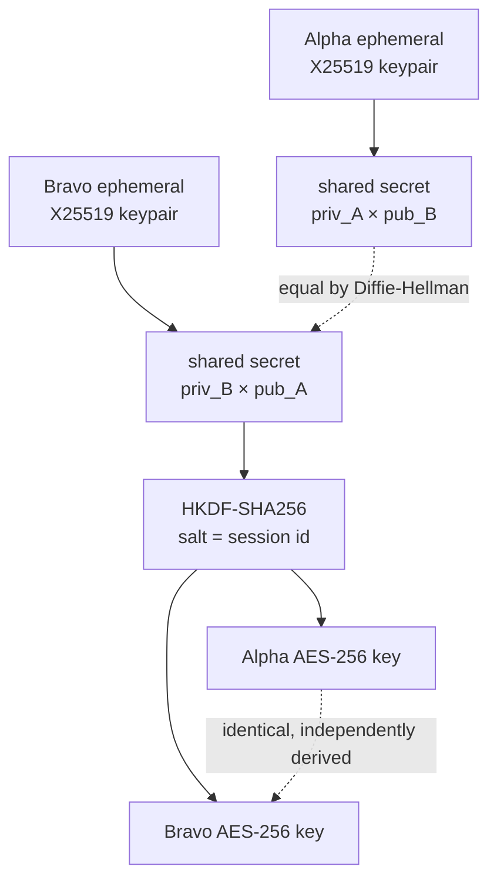
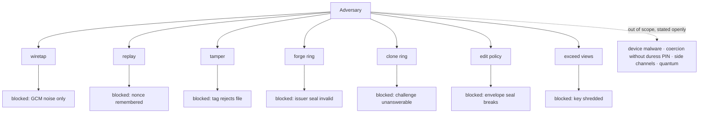

# LETHE — The Ring That Holds the Key to Nothing

> **Zero-trust, offline, wearable-NFC-anchored secure file exchange.**
> Two devices. One tap. A key that is never sent — and then destroyed.
> Resistant to all known attack vectors within the stated threat model. Never "unhackable".



## Run it (no server, no internet)

```powershell
pip install -r requirements.txt
python lethe_product.py        # 8-scene cinematic demo, ENTER steps through scenes
python lethe_product.py --auto # straight run, for recording
python lethe_self_test.py      # 14 protocol invariants, green
python lethe_attacks.py        # 14 attacks, all blocked
```

## Two terminals, two devices (the evaluator run)

```powershell
# Terminal 1 (projector): the receiver waits
python lethe_recv.py
# Terminal 2: the sender taps, authenticates, and hands over the file
python lethe_send.py
```

Two OS processes, zero pre-shared state — fresh identities, rings, and keys
on both sides, agreeing over a shared field directory exactly as two phones
would agree over radio hops. Watch both session keys match.

## Anatomy of one transfer



## Where the key comes from (and why it is never sent)



There is nothing to intercept because nothing travels. The key exists in two memories at once, briefly — then Phase 9 deletes the mathematics.

## The ring: 128 bytes of trust

```
NTAG215 · 504 bytes usable · we occupy 128

+-----------------------------------------------+
| Owner ID            16 B   UUID of this ring  |
| Device public key   32 B   ed25519            |
| Recovery hash       16 B   SHA-256(code)[:16] |
| Issuer signature    64 B   ed25519 over above |
+-----------------------------------------------+
| Free                         ~376 B           |
+-----------------------------------------------+
```

The ring is a key, not a container. A photograph is 3,000,000 bytes; the ring could not hold the file if it wanted to. It holds identity. The file flies over Wi-Fi Direct. The ring opens the door; the file walks through.

## Module map (phase → file → proof)

| Phase | Module | What it proves |
|---|---|---|
| 1 | `lethe/identity.py` | ed25519 identity per device; private key keystore-only |
| 2 | `lethe/ring.py` | Provisioning, 128 B packing, issuer attestation |
| 3 | `lethe/tap.py` | `NfcField` — signed tap messages; replay window + nonce memory |
| 4 + 5 | `lethe/handshake.py` | Challenge-response auth + session-key agreement |
| 5 | `lethe/keys.py` | ECDH, HKDF derivation, FSKE forward-secure sub-keys per chunk |
| 6 + 7 | `lethe/transfer.py` | AES-256-GCM 64 KB frames `nonce(12)‖len(4)‖ct(+16 tag)`, verified per chunk |
| 8 | `lethe/policy.py` | PCCP signed envelope: `max_views`, `expires_at`, `recipient`, destruction mode |
| 9 | `lethe/erasure.py` | Self-wiping key slot: buffer zeroed, slot file wiped + unlinked |

## Threat model (what is blocked, what is declared out of scope)



Full battery in `lethe_attacks.py` — 14 blocked, 0 breaches. Honest limitations documented alongside, per the security model: device compromise, physical coercion, side channels, and quantum adversaries are outside the stated threat model.

## Grounding: the base paper, reproduced

`basepaper/` is a faithful implementation of **An Offline Direct Authentication Scheme for the Internet of Medical Things Based on Elliptic Curve Cryptography** (Maarouf, Sakr, Elmougy — IEEE Access, Vol. 12, 2024, DOI 10.1109/ACCESS.2024.3458424): brainpoolP256r1 arithmetic from scratch, the 5-step login with ECCDHP session-key agreement, single-use sessions, and strict frame validation — 14/14 attacks rejected (10 from the paper plus step-5 replay, truncated frames, unprovisioned login, and off-curve registration).

```powershell
python product.py    # 6-scene base-paper demo
python demo.py       # install → register → mutual auth → session key
python attacks.py    # paper attack battery
python self_test.py  # group laws, ECCDHP, forward secrecy
```

## Status

- [x] Base paper: 5-step mutual auth, ECCDHP key agreement, single-use sessions, 14/14 attacks rejected
- [x] LETHE phases 1–9 running on PC: 14/14 self-tests, 14/14 attacks blocked
- [ ] NFC rings to procure; ACR122U reader deliberately skipped (phone provisioning, never in ceremony): `NfcField` is the seam the real tap drops into
- [ ] Wi-Fi Direct socket, Android shell, TERA attestation, CoRDe duress PIN, Tamarin model

## The one honest paragraph

The cryptography is real — ed25519, X25519, HKDF-SHA256, AES-256-GCM, challenge-response, signed policy, key shredding. A genuine file is encrypted, transferred, opened once, then mathematically destroyed. Simulated: the 10 cm NFC radio hop (a signed file stands in for the NDEF read) and the Wi-Fi Direct socket (a local handoff under the identical key). The mathematics cannot tell which radio carried its inputs — bytes are bytes.
